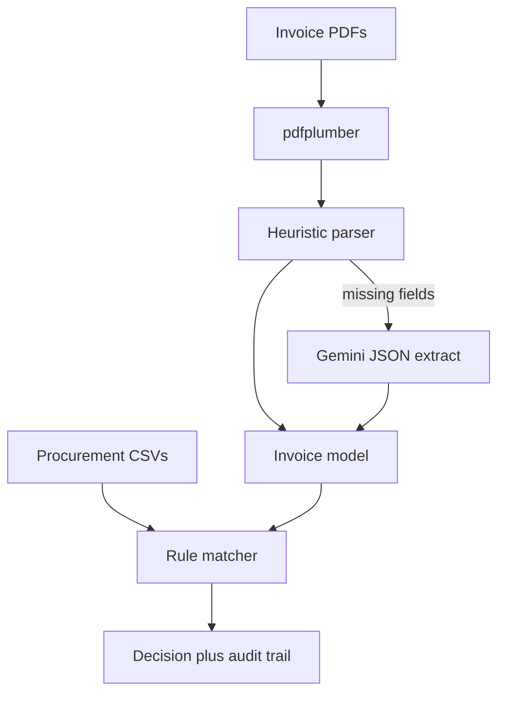

# Invoice processing — PDF to decision

A Python prototype that takes vendor invoice PDFs, extracts the fields an AP team would look at, matches them against a stand-in procurement system, and returns an explainable **APPROVE / REVIEW / REJECT** decision.

This repo implements the happy-path pack in `input_dataset/`: seven clean, machine-readable invoices that should all approve. Email/Drive intake, OCR for scans, and a UI are out of scope for this version.

All companies, tax IDs, bank accounts, people, and email addresses in the dataset are fictional.

## Problem

A mid-size company receives vendor invoices as PDFs. Someone on AP opens each one, finds the matching purchase order, checks the numbers, and decides what to do. Layouts differ by vendor: PO references are written differently, dates and amounts use mixed formats, tax may be CGST+SGST or IGST, and line-item tables wrap awkwardly.

The prototype automates that loop for the happy path, and keeps every decision auditable.

## Design principles

- **Deterministic matching.** Amounts, GST math, PO status, and line-item checks run in Python. The LLM does not invent totals.
- **LLM as fallback, not the default.** `pdfplumber` plus heuristics extract the happy-path pack without a model call. Gemini is used only when required fields are missing, or when you opt into the agent loop.
- **Explainable outcomes.** Each run writes a check-by-check audit trail (`VENDOR_GSTIN`, `PO_AMOUNT`, `LINE_ITEMS`, and so on).
- **Same tools, two runners.** `python -m src.pipeline` is a plain folder walk. `--agent` asks Gemini to call the same extract / lookup / validate tools.

## How a file is processed

```
PDF  →  pdfplumber (text + tables)
     →  heuristic parse (GSTIN, PO, dates, amounts, lines)
     →  Gemini structured extract   [only if required fields are missing]
     →  vendor / PO / line / GST / duplicate checks
     →  APPROVE | REVIEW | REJECT  + reasons
     →  output/results.json
```



## Repository layout

```
.
├── README.md
├── requirements.txt
├── pytest.ini
├── .env.example
├── input_dataset/          Happy-path pack (PDFs + procurement CSVs)
│   ├── README.md
│   ├── invoices/
│   └── data/
├── src/
│   ├── pipeline.py         CLI entrypoint
│   ├── agent.py            Optional Gemini tool-calling loop
│   ├── validate.py         Deterministic checks and outcome
│   ├── master_data.py      CSV loaders
│   ├── models.py           Invoice, LineItem, CheckResult, Decision
│   ├── config.py           Paths, API key, amount tolerance
│   └── extract/
│       ├── pdf.py          pdfplumber text + tables
│       ├── parse.py        Heuristic field parser
│       ├── llm.py          Gemini fallback
│       └── service.py      extract_invoice() orchestration
├── tests/
├── output/                 Written at runtime (gitignored)
└── .env                    Local secrets (gitignored; create from .env.example)
```

## Requirements

- Python 3.11+ (developed on 3.14)
- Optional: a Google Gemini API key if you want LLM fallback or `--agent`

## Setup

```powershell
cd "c:\Users\chett\OneDrive\Desktop\start zamp"
python -m pip install -r requirements.txt
copy .env.example .env
```

Edit `.env`:

```
GOOGLE_API_KEY=your-key-here
GEMINI_MODEL=gemini-3.8-flash
```

`GOOGLE_API_KEY` can stay empty if you only run `--no-llm`. The default model id is `gemini-3-flash` if `GEMINI_MODEL` is unset; set it to the Flash model your account actually has (this project uses `gemini-3.8-flash`).

Do not commit `.env`. `.env.example` should contain placeholders only.

## Run the pipeline

Process every PDF in the happy-path pack (heuristics only — no Gemini call):

```powershell
python -m src.pipeline --no-llm
```

Equivalent with explicit paths:

```powershell
python -m src.pipeline --invoices input_dataset/invoices --data input_dataset/data --output output --no-llm
```

Enable Gemini fallback when a PDF is missing required fields:

```powershell
python -m src.pipeline
```

Route each invoice through the tool-calling agent (needs `GOOGLE_API_KEY`):

```powershell
python -m src.pipeline --agent
```

`--agent --no-llm` still uses the agent loop for orchestration, but extraction stays heuristic.

### CLI flags

| Flag | Default | Meaning |
|---|---|---|
| `--invoices` | `input_dataset/invoices` | Folder of PDF invoices |
| `--data` | `input_dataset/data` | Folder of procurement CSVs |
| `--output` | `output` | Where `results.json` is written |
| `--no-llm` | off | Never call Gemini during extraction |
| `--agent` | off | Gemini tool loop instead of the plain pipeline |

On the happy-path pack you should see seven `APPROVE` rows, each matching `expected_outcomes.csv`.

## Tests

```powershell
python -m pytest tests -v
```

Coverage includes amount/date/PO normalisation, heuristic extraction of a Nimbus invoice, Sundial’s `PO: 2026/1014` form, the full 7/7 approve pack, LLM merge behaviour without a live API call, and agent fallback when no API key is set.

## Decision rules

Required extracted fields: invoice number, invoice date, vendor GSTIN or name, PO number, line items, subtotal, tax, total.

Then, in order:

1. **Vendor** — GSTIN on `vendor_master.csv` (name fuzzy-match at score ≥ 85 if GSTIN is missing); `approval_status` must be `Approved`.
2. **PO** — number found, `status == Open`, `vendor_id` matches the invoice vendor.
3. **Amounts** — invoice total ≤ PO `remaining_balance` (tolerance `0.05`); subtotal ≤ remaining PO net. Split invoices against one PO are allowed. Over-balance is **REVIEW**.
4. **GST / arithmetic** — tax ≈ invoice subtotal × PO GST rate (not the full PO net); subtotal + tax ≈ total.
5. **Lines** — each invoice line matches a PO line on unit price, with qty ≤ remaining qty on that line. Unused PO lines are fine. Description / HSN / item code are tie-breakers.
6. **Duplicates** — same invoice number + vendor must not already exist in `invoice_history.csv` or earlier in the same run. Approvals decrement remaining balance and remaining qty in memory.
7. **Bank** — account / IFSC compared to vendor master as a **warning only**; a mismatch does not reject in v1.

### Outcomes

| Outcome | When |
|---|---|
| **APPROVE** | All required checks pass |
| **REVIEW** | Incomplete extraction, unknown vendor, missing PO, or amount/line/GST mismatch |
| **REJECT** | Vendor found but not approved; PO closed or belongs to another vendor; duplicate invoice |

### Check codes

`REQUIRED_FIELDS`, `VENDOR_GSTIN`, `VENDOR_NAME`, `VENDOR_IDENTITY`, `VENDOR_APPROVED`, `PO_FOUND`, `PO_OPEN`, `PO_VENDOR`, `PO_AMOUNT`, `PO_NET`, `GST_MATH`, `INVOICE_ARITHMETIC`, `LINE_ITEMS`, `DUPLICATE`, `BANK_DETAILS`.

## Extraction quirks handled without an LLM

The seven vendors format invoices differently. Heuristics cover:

- PO labels: `PO Number`, `PO Ref`, `Your Order Ref`, `PO No.: PO 2026-1012`, `PO Reference: PO: 2026/1014` → normalised to `PO-YYYY-NNNN`
- Dates: `12 Oct 2026`, `2026-10-13`, `14/10/2026`, `October 16, 2026`
- Amounts: Western `343,380.00` and Indian `1,00,300.00`
- Tax: intra-state CGST 9% + SGST 9%, or interstate IGST 18%
- Line items from `extract_tables()` when present, otherwise regex over `extract_text()`

## Dataset

See [`input_dataset/README.md`](input_dataset/README.md) for field-level documentation. Short version:

| File | Role |
|---|---|
| `invoices/*.pdf` | Inputs (text PDFs, no scans) |
| `data/vendor_master.csv` | Approved vendors, GSTIN, bank, billing email |
| `data/purchase_orders.csv` | Open POs, totals, remaining balance |
| `data/po_line_items.csv` | Ordered qty, unit price, HSN/SAC |
| `data/invoice_history.csv` | Prior invoices (empty on this pack) |
| `data/expected_outcomes.csv` | Answer key — all `APPROVE` |

Linked by `vendor_id` and `po_number`. Buyer on every invoice is the same fictional company (Meridian Retail Pvt Ltd).

## Output

`output/results.json` has two arrays:

- **`summary`** — file, actual outcome, expected outcome, match flag, `vendor_id`, `po_number`, reasons
- **`review_queue`** — REVIEW and REJECT items for a human AP queue
- **`decisions`** — full `Decision` objects: extracted invoice, every `CheckResult`, and the final outcome

## Agent tools

When `--agent` is set, Gemini may call:

| Tool | What it does |
|---|---|
| `extract_invoice` | Parse a local PDF path into structured JSON |
| `lookup_vendor` | Find a vendor by GSTIN or name |
| `lookup_po` | Return a PO header and its line items |
| `validate_invoice` | Run the Python rule engine |

If `GOOGLE_API_KEY` is missing, the agent runner falls back to extract + validate locally.

The rule engine is always the source of truth for APPROVE / REVIEW / REJECT. The model only chooses which tools to call.

## Configuration

Defined in [`src/config.py`](src/config.py):

| Name | Source | Default |
|---|---|---|
| `GOOGLE_API_KEY` | `.env` | empty |
| `GEMINI_MODEL` | `.env` | `gemini-3-flash` |
| `AMOUNT_TOLERANCE` | code | `0.05` |
| Invoice / data / output dirs | CLI or code | `input_dataset/…`, `output/` |

## Not in this version

- Gmail Apps Script / Google Drive intake
- OCR for scanned image PDFs
- UI
- Split-PO billing, over-tolerance, missing invoice numbers, and other edge packs

Those are the next iteration after this pack stays at 7/7 APPROVE.

## License / data

Prototype and test data only. Do not treat the invoices or master files as real commercial records.
